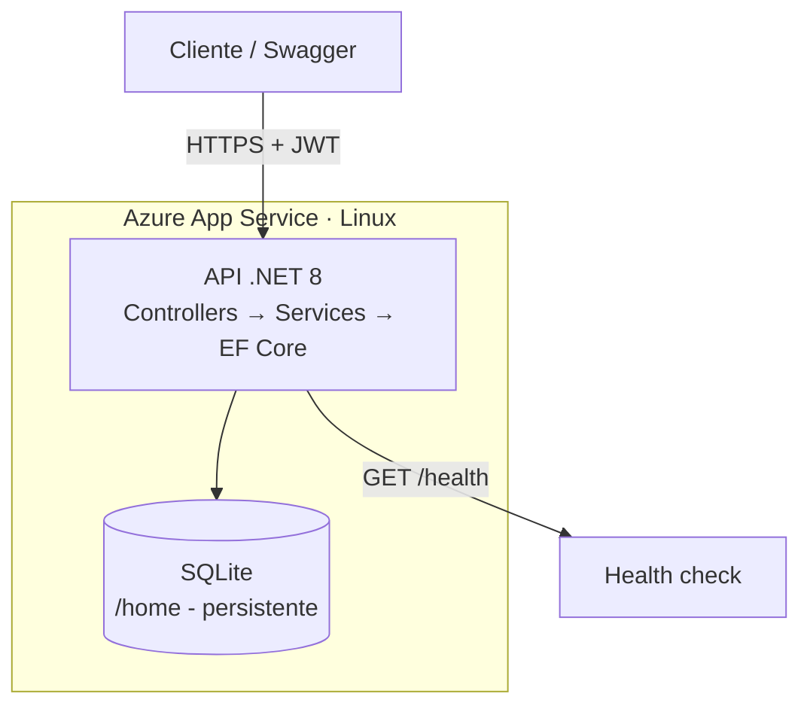
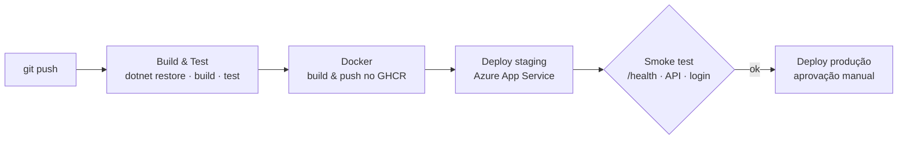

<h1 align="center">♻️ Cidades ESGInteligentes</h1>
<p align="center"><b>API de gestão de resíduos e reciclagem que avisa quando um ecoponto está prestes a lotar — com CI/CD, Docker e deploy em nuvem totalmente automatizados.</b></p>

<p align="center">
  
  
  
  
  
  
  
  
  
  
  
</p>

<p align="center">
  <!-- Troque USUARIO/REPO pelo seu repositório -->
  <a href="https://github.com/USUARIO/REPO/actions"></a>
</p>

---

## 🔥 O problema

Em muitas cidades, os pontos de coleta seletiva funcionam no escuro:

- **Ecopontos transbordam** antes da próxima coleta e o material reciclável vira lixo comum ou acaba na rua.
- **Caminhões fazem viagens em vão** para pontos ainda vazios, enquanto outros lotados esperam, com custo de combustível, tempo e emissões.
- **Não há dados**: a gestão não sabe o que é descartado, onde e em que volume, então não consegue planejar rotas nem investir onde importa.

## 💡 A solução

Uma API que dá **visibilidade em tempo real** sobre a capacidade de cada ecoponto e **aciona a coleta no momento certo**:

1. Cada **descarte** registrado atualiza a carga do ponto de coleta.
2. Ao atingir **80% da capacidade**, a API **gera um alerta automaticamente**.
3. O **gestor** consulta e resolve os alertas e acompanha o **relatório consolidado** por tipo de resíduo e por ponto.

Resultado esperado: coleta orientada por dado, e não por calendário fixo, com menos transbordos, menos deslocamentos desnecessários e decisões baseadas em números.

| Perfil | O que pode fazer |
|---|---|
| **Operador** | Registrar descartes |
| **Gestor** | Gerenciar pontos de coleta, resolver alertas e consultar relatórios |

## 🧰 Tecnologias em destaque

| Camada | Tecnologia | Por que está aqui |
|---|---|---|
| **Backend** | **C# · .NET 8 · ASP.NET Core Web API** | API REST em camadas (Controllers → Services → Data) |
| **Dados** | **Entity Framework Core 8 · SQLite** | Persistência com seed inicial e criação automática do schema |
| **Segurança** | **JWT Bearer · autorização por papéis** | Operador e gestor com permissões distintas |
| **Mapeamento** | **AutoMapper** | Separa entidades de domínio dos ViewModels expostos |
| **Documentação** | **Swagger / OpenAPI** | Contrato da API navegável e testável no navegador |
| **Testes** | **xUnit · Mvc.Testing** | Testes de integração com `WebApplicationFactory` por controller |
| **Containers** | **Docker (multi-stage) · Docker Compose** | Imagem enxuta, usuário não-root, healthcheck e volume persistente |
| **CI/CD** | **GitHub Actions** | Build, testes, imagem e deploy a cada push, sem intervenção manual |
| **Registry** | **GitHub Container Registry** | Imagem versionada por SHA do commit |
| **Nuvem** | **Azure App Service (Web App for Containers)** | Ambientes de **staging** e **produção** separados |

## 🏗️ Arquitetura



## 🚀 Pipeline CI/CD

Do `git push` ao ambiente rodando, sem passos manuais (exceto a aprovação opcional de produção):



| Etapa | Quando roda | O que faz |
|---|---|---|
| **build-test** | push e pull request | `dotnet restore`, `build` e `test` (xUnit) em Release; publica o relatório .trx |
| **docker** | push em main/develop | Build do Dockerfile e push ao GitHub Container Registry (tags: SHA do commit e `latest`/`develop`) |
| **deploy-staging** | push em main/develop | Publica a imagem do commit no Web App de staging (`azure/webapps-deploy`) e executa smoke test |
| **deploy-production** | push em main | Só após o staging passar; Environment `production` com aprovação manual opcional; mesmo deploy e smoke test |

**Princípio: build once, deploy anywhere.** A mesma imagem (tag = SHA do commit) validada em staging é a promovida para produção; apenas as variáveis de ambiente mudam.

<details>
<summary><b>⚙️ Configuração do GitHub e do Azure</b></summary>

**Secrets e variables do repositório** (Settings > Secrets and variables > Actions):

| Tipo | Nome | Valor |
|---|---|---|
| Secret | `AZURE_PUBLISH_PROFILE_STAGING` | Publish profile do Web App de staging |
| Secret | `AZURE_PUBLISH_PROFILE_PRODUCTION` | Publish profile do Web App de produção |
| Variable | `AZURE_APP_STAGING` | Nome do Web App de staging |
| Variable | `AZURE_APP_PRODUCTION` | Nome do Web App de produção |

**Infraestrutura**: 1 Resource Group, 1 App Service Plan Linux **B1** compartilhado e 2 Web Apps em modo Container. Variáveis de ambiente de cada Web App:

| Nome | Staging | Produção |
|---|---|---|
| `ASPNETCORE_ENVIRONMENT` | `Staging` | `Production` |
| `Jwt__Key` | chave aleatória (32+ caracteres) | outra chave |
| `Swagger__Enabled` | `true` | `false` |
| `DisableHttpsRedirection` | `true` | `true` |
| `WEBSITES_PORT` | `8080` | `8080` |
| `WEBSITES_ENABLE_APP_SERVICE_STORAGE` | `true` | `true` |
| `ConnectionStrings__DefaultConnection` | `Data Source=/home/reciclagem.db` | `Data Source=/home/reciclagem.db` |

**Decisões de custo**: um único plano B1 hospeda os dois ambientes (slots de deployment exigem plano Standard) e as imagens ficam no GHCR, gratuito, em vez de um Azure Container Registry pago.

</details>

## 🐳 Containerização

Dockerfile multi-stage:

```dockerfile
# syntax=docker/dockerfile:1

# ---------- Stage 1: build (SDK .NET 8) ----------
FROM mcr.microsoft.com/dotnet/sdk:8.0 AS build
WORKDIR /src
# restore em camada separada para aproveitar o cache
COPY src/Fiap.Api.Reciclagem/Fiap.Api.Reciclagem.csproj Fiap.Api.Reciclagem/
RUN dotnet restore Fiap.Api.Reciclagem/Fiap.Api.Reciclagem.csproj
COPY src/Fiap.Api.Reciclagem/ Fiap.Api.Reciclagem/
RUN dotnet publish Fiap.Api.Reciclagem/Fiap.Api.Reciclagem.csproj \
    -c Release -o /app/publish --no-restore /p:UseAppHost=false

# ---------- Stage 2: runtime (ASP.NET 8, imagem leve) ----------
FROM mcr.microsoft.com/dotnet/aspnet:8.0 AS final
WORKDIR /app
COPY --from=build /app/publish .
# diretorio do SQLite (montado como volume) com permissao para o usuario nao-root
RUN mkdir /data && chown $APP_UID /data
USER $APP_UID
ENV ASPNETCORE_URLS=http://+:8080 \
    ConnectionStrings__DefaultConnection="Data Source=/data/reciclagem.db"
EXPOSE 8080
# a imagem aspnet nao tem curl/wget: healthcheck via bash (/dev/tcp)
HEALTHCHECK --interval=15s --timeout=5s --start-period=20s --retries=5 \
  CMD bash -c 'exec 3<>/dev/tcp/127.0.0.1/8080 && printf "GET /health HTTP/1.0\r\nHost: localhost\r\n\r\n" >&3 && head -n1 <&3 | grep -q " 200 "' || exit 1
ENTRYPOINT ["dotnet", "Fiap.Api.Reciclagem.dll"]
```

**Boas práticas aplicadas**
- **Multi-stage**: o SDK fica só no build; a imagem final contém apenas o runtime ASP.NET.
- **Cache de camadas**: `restore` separado do `publish`.
- **Segurança**: execução com **usuário não-root**; segredos fora da imagem, via variáveis de ambiente.
- **Observabilidade**: endpoint `/health` e `HEALTHCHECK` próprio (a imagem aspnet não tem curl).
- **Persistência**: volume para o banco, no Compose e no Azure.

Orquestração local (`docker-compose.yml`): serviço `api` na rede `reciclagem-net`, volume `reciclagem-data` em `/data`, variáveis do `.env` e porta configurável.

## ▶️ Como executar localmente com Docker

Pré-requisito: Docker com Compose v2.

```bash
git clone https://github.com/USUARIO/REPO.git && cd REPO
cp .env.example .env              # defina JWT_KEY (openssl rand -hex 32)
docker compose up -d --build
docker compose ps                 # aguarde o status "healthy"
curl http://localhost:8080/health
```

- **Swagger**: http://localhost:8080/swagger
- **Login de demonstração**: `POST /api/Auth/login` com `{"username":"gestor01","password":"pass123"}` (também existe `operador01`)
- Logs: `docker compose logs -f api` · Parar: `docker compose down` (`-v` apaga o banco)
- Sem Docker (SDK .NET 8): `dotnet run --project src/Fiap.Api.Reciclagem` e `dotnet test src/Fiap.Api.Reciclagem.Tests`

### Endpoints

| Endpoint | Descrição |
|---|---|
| `POST /api/auth/login` | Gera token JWT |
| `/api/pontocoleta` | CRUD de pontos de coleta, com listagem paginada (escrita restrita ao `gestor`) |
| `/api/descarte` | Registro de descartes; gera alerta automático ao atingir 80% |
| `/api/alerta` | Consulta e resolução de alertas |
| `GET /api/relatorio/resumo` | Totais por tipo de resíduo e por ponto de coleta |
| `GET /health` | Health check usado pelo Docker e pelo pipeline |

## 🧱 Tecnologias utilizadas

**C#** · **.NET 8** · **ASP.NET Core Web API** · **Entity Framework Core 8** · **SQLite** · **AutoMapper** · **JWT Bearer** · **Swagger/OpenAPI** · **xUnit** · **Microsoft.AspNetCore.Mvc.Testing** · **Docker** · **Docker Compose** · **GitHub Actions** · **GitHub Container Registry** · **Azure App Service**
